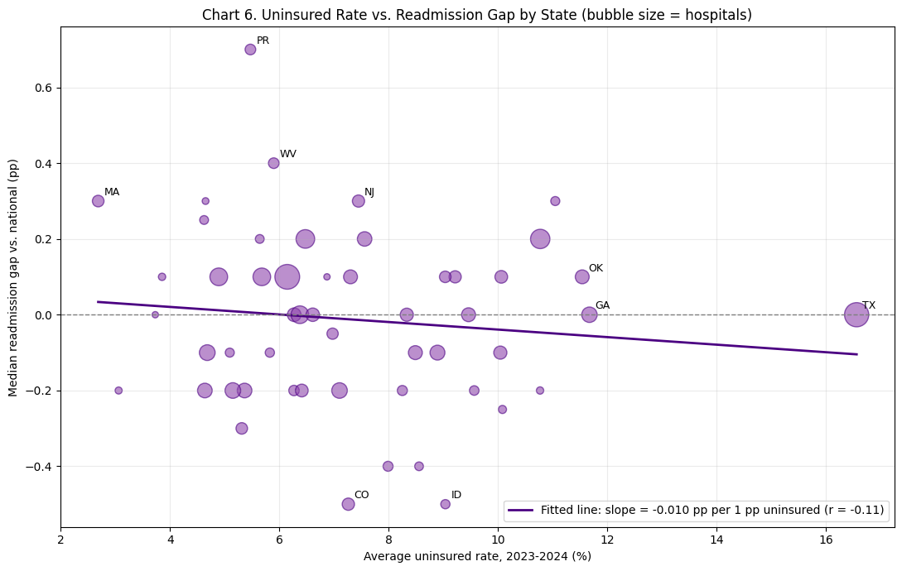
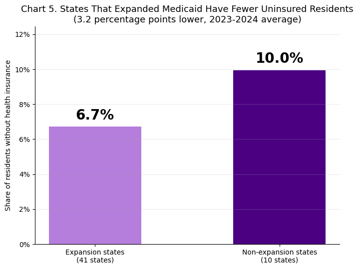
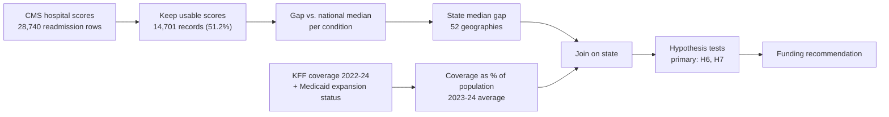

<h1 align="center">Hospital Readmissions vs. Insurance Coverage</h1>

<p align="center">
  <b>Does covering more people reduce 30-day hospital readmissions?</b><br>
  A state-level test across 52 U.S. geographies, built to inform a funding decision.
</p>

<p align="center">
  <a href="https://colab.research.google.com/github/samarthk0403/hospital-readmissions-vs-coverage/blob/main/A02-Healthcare-Equity-Hospital-Readmissions-and-Insurance-Coverage.ipynb"></a>
  
  
  
</p>

---

## The decision

Under CMS's Hospital Readmissions Reduction Program, hospitals with higher-than-expected 30-day readmissions lose Medicare payment. A common argument says uninsured patients get less follow-up care and come back more often, so expanding coverage should cut readmissions and penalties.

A State Medicaid agency or hospital association has a fixed budget and two options:

1. **Fund coverage expansion** (outreach, Medicaid expansion).
2. **Fund care-transition programs** (discharge planning, follow-up calls, medication reconciliation).

This project asks whether the data support option 1 as a readmission strategy.

## Result

**At the state level, no.** States with more uninsured residents do not have worse readmission results.

<p align="center">
  
</p>

<p align="center"><sub>Each bubble is a state (size = number of reporting hospitals). Uninsured rates span 2.7% to 16.6%, yet readmission gaps show no trend.</sub></p>

| Question | Result | Verdict |
|---|---|---|
| Do higher uninsured rates go with higher readmission gaps? *(primary test, H6)* | r = -0.11, 95% CI [-0.37, +0.17]; r = -0.08 without Puerto Rico | Not supported |
| Do expansion states have lower readmission gaps? *(primary test, H7)* | Difference of -0.01 pp, Cohen's d = -0.07, p = 0.40 | Not supported |
| Does Medicaid expansion lower uninsured rates? *(H5)* | 6.72% vs. 9.96%, d = -1.41 | Supported |
| Does a larger Medicaid share go with higher gaps? *(H10)* | r = +0.45, Holm p = 0.0014; r = +0.25 without Puerto Rico | Holds, but fragile |
| Are the same states above the national rate across conditions? *(H13)* | Average r = +0.61 | Consistent |

### Why the effect disappears

Expansion works at what it is designed to do: it cuts the uninsured rate by about 3 percentage points. That drop does not show up in readmissions.

<p align="center">
  
</p>

The likely reason is scale. State readmission gaps span only **1.20 percentage points**, while uninsured rates differ **6.2-fold** (Massachusetts 2.69% vs. Texas 16.56%). Coverage varies enormously between states, but readmission performance barely does.

## Recommendation

- **Judge coverage expansion on access and financial protection**, not as a readmission program.
- **To reduce readmissions, consider care-transition programs** aimed at states that sit above the national rate across several conditions (average cross-condition r = +0.61 means these states are persistent, not noisy).

We did not test care-transition programs. That half of the recommendation rests on the absence of a coverage effect and on published evidence cited in the notebook.

## How the analysis works



| Step | What happens |
|---|---|
| **1. Clean** | Keep the six 30-day readmission measures (AMI, heart failure, pneumonia, COPD, CABG, hip/knee). CMS suppresses 14,039 rows for small case counts; those are excluded. Coverage head counts become shares of each state's population. |
| **2. Normalize** | Compare each hospital score with the national median for the same condition, so a state is not penalized for treating a harder mix of conditions. |
| **3. Join** | Aggregate to a state median gap and join to KFF coverage. CMS and KFF match on 52 geographies (50 states, DC, Puerto Rico). |
| **4. Test** | Two primary tests (H6, H7) fixed before the final run. Secondary tests use Holm correction. One exploratory regression with robust (HC3) errors. Every test reports an effect size. |
| **5. Stress-test** | Re-run without Puerto Rico, against CMS's own worse/same/better ratings (H6b), and split by chronic vs. elective conditions and by hospital volume. No verdict changes without Puerto Rico. |

## Data

| Dataset | Publisher |
|---|---|
| [Unplanned Hospital Visits, Hospital](https://data.cms.gov/provider-data/dataset/632h-zaca) | CMS Provider Data Catalog |
| [Unplanned Hospital Visits, State](https://data.cms.gov/provider-data/dataset/4gkm-5ypv) | CMS Provider Data Catalog |
| [Health Insurance Coverage of the Total Population, 2022-2024](https://www.kff.org/state-health-policy-data/state-indicator/total-population/) | KFF State Health Facts |
| [Status of State Medicaid Expansion Decisions](https://www.kff.org/status-of-state-medicaid-expansion-decisions/) | KFF |
| [Status of State Action on the Medicaid Expansion Decision](https://www.kff.org/affordable-care-act/state-indicator/state-activity-around-expanding-medicaid-under-the-affordable-care-act/) | KFF State Health Facts |

CMS data are U.S. government public data. KFF data are used under KFF's terms of use with attribution. CMS reports one pooled period (July 2023 to June 2025), so it is compared with the 2023-2024 average of KFF coverage rather than matched year by year.

## Run it

Click the **Open in Colab** badge at the top. The notebook loads copies of the five source files from shared Google Drive links, so no local paths or setup are needed. Run all cells in order; the first code cell installs nothing beyond the standard Colab environment.

## Limitations

- **Population mismatch.** CMS scores come from Medicare patients, while KFF coverage describes everyone. A null result means "no evidence through this state-level proxy", not "insurance does not matter".
- **State-level only.** The analysis cannot speak to individual patients. Next step: patient-level data and a fuller model.
- **Small, suppressed samples.** 48.8% of readmission rows are suppressed by CMS, and CABG has fewer than 1,000 usable records.
- **Puerto Rico is an outlier** on Medicaid share (47.0%, next highest 33.7%). It is excluded from the expansion tests, which do not apply to it, and reported with and without elsewhere.

## Repo contents

```
.
├── A02-Healthcare-Equity-Hospital-Readmissions-and-Insurance-Coverage.ipynb   # full analysis, 15 charts
├── chart6-uninsured-vs-gap.png                                                # README image
├── chart5-expansion-vs-uninsured.png                                          # README image
└── README.md
```

## Team

BA780 Intro to Data Analytics, Boston University (MSBA), Fall 2026. Cohort A, Team 02.

Aqsa Siddique, Samarth Karan, Ting Hui Chu, Dhruv Shah
